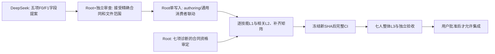

# A-INTAKE-CLOSEOUT-01 — 七人组接入验证收尾

日期：2026-11-06（Asia/Shanghai）。实施负责人：Root。**本批 A 修复限定技术审查通过；整体 NOT_ACCEPTED，Integration NO。没有合并、正式迁移或 coverage credit。**

代码／测试候选：`4c744e103b7c86dd1a1b3eb911c2f5e919aac5cb`。Base：`3eb03496940be9a6635dc402cd8f55e52ef2b618`。工作区：`D:/fd-validation/a-b-ci-reconcile-20261105`，分支 `codex/a-b-ci-reconcile-20261105`。没有把该分支当最新 main，也没有声称具备直接 promotion 条件。

## 1. 实际完成的 A 修复

| 问题 | 最终行为与证据 |
| --- | --- |
| Luck 普通战败错误抑制 | 普通军事罚分仍为实际 margin 的负值；普通败者、首次战败和恢复后的事实不再被免疫标记吞掉；显式【败北】状态免疫保留。依据仓库 b39 已记录 A3 用户裁定，不重新索要规则确认。 |
| 前半数顺位读点 | 按 startingSeat 轮转并跳过淘汰者后计算前半数，不按永久座号；Tomoe 的牌使用要求仍需 B 放到正确字段层，不能据此称整张牌通过。 |
| 移动令咒目标变化 | 挂起后恢复、关闭地点变化、伪造目的地、错误控制者、旧选择重放均由服务端重验；费用只支付一次，客户端私有选择与实际位置一致。 |
| Alter 持续禁宝具 | 从当前有效来源读取当前魔力与同场对手条件，7↔8变化不再遗漏或锁死；涵盖非技能类宝具的 schema 边界。限制额外条件／响应／执行／可见性语义，旧 ongoing 按来源+能力身份处理。 |
| Soul Drag 合计威力 | 取真实激活轮 playedRound 快照，一次性加入 battle.totalPower；不会给每张攻击再加一遍。重复刷新不叠加，跨回合保留原快照，恢复一致，未激活或离场来源不提供加成。 |

只修改三个生产文件：`packages/rules/src/core/combat-resolver.ts`（buildBattleResultFromRanked/resolveBattlefield）、`packages/rules/src/ability/interpreter.ts`（candidates/condition/静态禁用合同及读点）、`packages/rules/src/ability/extended-effects.ts`（resolveExtendedEffect 的 soul_drag_power_bonus 分支）。没有修改生产 authoring、生成库、Loader、MatchSession 或旧冻结工作树。

实现提交：`d5d8a489`（前四项及旧测试合同收敛）、`4c744e10`（Soul Drag 及组合回归）。旧 `b052183a`、`3eb03496` 和 `d5d8a489` 原始收据保留。

## 2. 已执行的三级验证

| 范围 | 实测结果 | 证据目录中的文件 |
| --- | --- | --- |
| 七人组编译与声明 | 14 档案、94 身份全部注册，0 missing，0 非 automatic 声明；只证明编译／声明 | compiled-identities.json |
| 既有 RC／合法性及肯尼斯 84 项 | 在最终完整 CI 中对应 84 项全部通过；不能替代所有技能效果验收 | focused-final-03.json（历史定向）、final-ci.json（当前绑定） |
| 本批 Soul Drag／组合／原回归 | 64 PASS /1 FAIL；唯一失败是起源弹实际损失绑定；无日志代替实际效果 | aggregate-followup-02.json；最终 CI 含同名用例 |
| 额外七御主令咒 L1/L2 | **77 PASS /0 FAIL，退出0**：21正常费用/结果/投影，21零资源拒绝，21错误控制者，7私有移动恢复/目标变化/重复选择，7胜利奖励恢复/实际公共 VP/幂等 | seven-seals-final.json、seven-seals-final-receipt.json、resource-projection/resource-projection.test.ts |
| 完整 CI，同一最终代码 SHA | **1930 PASS /19 FAIL /0 SKIP，214文件，自然退出1；TEST_FAILURE** | final-ci.json/log、final-ci-receipt.json |
| 客户端／服务端单测 | 66/66、24/24，通过；文件字节与最终代码候选一致 | client-tests.json/log、server-tests.json/log |
| 类型／客户端构建 | 自然退出0 | typecheck-aggregate.log、client-build.log |
| 七人真实 HTTP +8路 WS | 三场均 round11 终局；697 /691 /531 次命令，所选投影动作被拒绝／隐私／不变量违规计数为0；预期 stale／越权反例另记 | wire-final-scoped/*.json、final-wire-scoped-receipt.json |
| 浏览器／真实服务端 | **5/5 PASS，退出0**：普通行动及公开威力、七浏览器11回合与重连、鲜进程恢复、真实起源弹替换/抽取/重连/stale | browser-final/results.json、final-browser.log、final-browser-receipt.json |

最终完整 CI：2026-11-06 19:39:17.663 开始，19:49:23.496（Asia/Shanghai）自然结束，退出1；没有将其解释为 timeout 或环境问题，也不把77项额外通过加到CI计数中。

77项中的7个胜利奖励用例显式构造可信的战后事件作为L2起点，断言实际VP变化与公共投影；不宣称这些单项都自然完成战算。矩阵 resume=N/A 仅表示无技能专属挂起选择，不豁免持续状态快照、重连及通用恢复验证。

七人联机／浏览器是 L3 整体基线，不逐技能跑完整对局，也不表示94条效果全部覆盖。本机真实 HTTP/WS 结果不代表尚未配置的 Sakura 公网隧道已验收。

按用户排除项：新主动联机策略让慎二保持保守、不主动发动可选能力，显式核对更换分支 events/logs 均为0；他的其他技能由有界 L1 单独覆盖。完整 CI 仍保留已有历史回归入口，不将其历史测试等同本轮更换御主技能准入。

## 3. 旧失败与历史测试迁移

此前最后剩余11个历史失败（定向153项142/11）在当前相应五文件为153/153通过。肯尼斯指纹项已由前一专项授权与版本审查关闭。本次旧清单关闭不意味着新扩展用例通过。

迁移有独立合同依据：事件维持正常20槽/18唯一，拆分总注册23与精确5个不入正常牌堆的补充事件；Luck 断言普通军事罚分并保留状态免疫反证；Tomoe 单卡6不变、resolver合计12只减5；原 directive 断言改为真实费用、移动、激活、威力或受控效果证据，仍有效的来源/牌库/触发账本保留；地利保留空槽身份，不用压缩数组改变位置数值。Source provenance 见 test-migration-sources.json 和 contract-review.md/json。没有整批复制历史 PASS，所有移入测试均先执行并保留红结果。

额外77项的前置条件曾不正确：工房已满却要求进入、常规出牌未完成却要求公开威力。保留原28/14结果，改为腾出合法容量、真实确认普通出牌；Iris 前哨强化延续到行动后再公开。没有按实际错误数值修改规则预期。

首个严格排除驱动也曾发现慎二用疾行进入战场、耗尽令咒触发排除分支；其原结果保留为驱动范围失败，未当产品漏洞或最终PASS。修正玩家策略后使用 wire-final-scoped 的三场零排除分支证据，不用先前 complete=true 掩盖 scope assertion failure。

## 4. 仍未关闭的19个失败

**12个已有规则依据的失败，集中于五项合同；另7项为未确立产品门禁的诊断。全部保留红结果，不可自行忽略、跳过或标PASS。** 逐案原名、文件、错误与Owner：`D:/fd-validation/a-intake-closeout-20261106/open-issues.json`。

| Task ID | 数量 | 必须解决的具体问题 | Owner／文件 |
| --- | ---: | --- | --- |
| B-FIELD-MAIYA-01 | 4 | 非舞弥必须先足额支付2 VP；先+1基础地利再翻倍；实际到期。当前费用被截断，且缺基础值加法字段。不能用固定+2最终地利替代运算次序。 | B提出规范化费用／地利字段，A实现接受后的共享消费者；master.maiya.json |
| B-FIELD-CASTER-01 | 4 | 普通 basic.luck 与生成 card.luck 的同卡语义在公式中统一计数，×5且上限15，不能替换一个ID后漏掉另一类。 | B authoring公式；servant.artoriac.json |
| B-FIELD-ERESH-01 | 2 | 需明确放置后可生效、可恢复且固定战场的场地状态，不规定必须用cardState.active或boardLocationId存储；同场+6必须合计一次、异场不增加；放置不能伪造成打出。 | B明确字段及Effect Plan，A补齐通用消费者；servant.ereshkigal.json |
| B-FIELD-TOMOE-01 | 1 | “前半数才能使用此牌”目前只放在能力条件，牌本身仍能被打出。顺位读点已修，字段必须落到牌使用准入层。 | B playRequirements；servant.tomoe.json |
| B-FIELD-ORIGIN-01 | 1 | 卧藤免疫后实际失去魔力0，起源弹却从2变8；第二步读初始快照，未读实际损失结果。普通9→6／2→8正例保留。 | B实际结果绑定表达，A typed execution；master.kiritsugu.json |
| A-ADMISSION-QUALIFICATION-01 | 7 | getter读取0的性能假设1；直接修改compiled pack的Eresh phase/scope2、Kayneth selector/lifecycle2、手牌/换主来源2。缺实际入口可达性或完整已接受合同；不得宣告已证实漏洞。先核实准入路径/适用依据，再决定正式反例或保留外部诊断，不能靠删测试变绿。 | Root +独立审查；不修改角色规则迁就假设 |

这五项均有现有卡牌原文／规则依据，不要求用户重复裁定。B回交前不在 A 侧硬编码角色ID补印文，也不把未规范化字段猜成 Runtime 语义。

Eresh 的CI首个放置失败是内部形状断言，不能单独视为规则依据。另补不依赖存储表示的实际消费者对照：普通打出时对手时局修正正确反转为−2（PASS），技能放置后在Owner位置变化前后仍为+2而非−2（两项FAIL，有界位置状态构造）。这才确认场地效果缺口；证据 placement-proof.json/receipt，1 PASS/2 FAIL，不增加或重写CI计数。

## 5. 逐技能矩阵及其真实限制

`docs/reports/2026-11-06-seven-roster-skill-acceptance.csv`：94 authored身份 +15单列的生成令咒动作消费者；唯一更换分支保留身份、执行 N/A。逐行含来源SHA256、候选、用例、编译、效果/费用/目标/非法/资源不足/投影/恢复/重复提交和当前证据。

矩阵的 PASS 只指列明断言的有界证据，**不是整张技能 ACCEPTED**。NOT_RUN 表示尚未在矩阵中建立该检查项的当前核验映射，不等于仓库没有相关测试。当前59行尚未形成逐身份可复核的执行映射，不能声称全94通过；后续由A继续补齐。正常事件、被动、共享消费者的现有测试可复用，不能用静态文本引用补成执行PASS。编译automatic也不证明效果正确。

## 6. 最短依赖路径与下一步

B可先只读并行准备，无共享 Runtime 写权限；A继续拥有本批消费者，候选写入冻结，Reservation未释放。B具体启动提示词与 external 输出落点：`D:/fd-validation/a-intake-closeout-20261106/B-START-PROMPT.md`。五份提案的技术Base为4c，不能当 main 或直接生产写入授权。

下一次完整 CI 的目的应是验证五项实际缺口及已审定的反例全部关闭后的新候选，不再无修改重复本次同一失败命令；先完成相应L1/L2、精确版本/依赖/文件所有权及恢复/隐藏信息验证。未来Promotion还须重新核对实际远端main和权限，不能直接把本地候选合入。

## 7. 独立审查与冻结状态

本批前四项：runtime-review.md/json；Soul Drag：aggregate-review.md/json。两者为限定技术审查通过；未授整体Gate A/B/C、全94接受、merge或credit。统一最终证据审查见 final-review.md/json。

所有原始证据目录：`D:/fd-validation/a-intake-closeout-20261106/`。最终绑定：final-binding.json。代码候选4c保持，后续报告提交只更新文档／授权审查阶段，不伪装新代码CI PASS。

`interpreter.ts`、`combat-resolver.ts`、`extended-effects.ts` 本批写入已冻结，**没有release/transfer**。Loader未进入本轮新写入范围，也不能从本报告推定其旧reservation已释放。D:/fd及原冻结候选未被重置、清理或覆盖；未操作PR #689/#690或任何合并。
